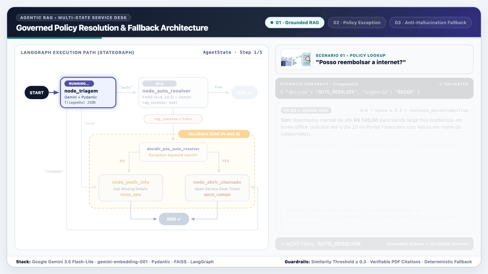
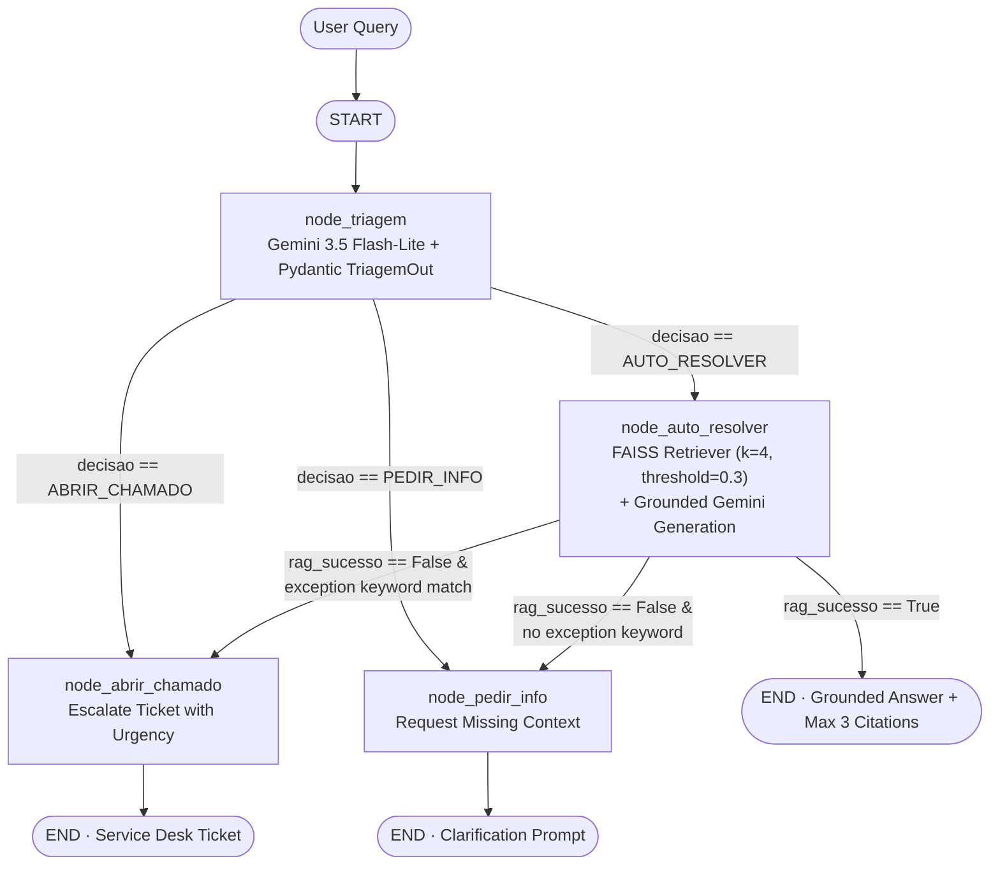
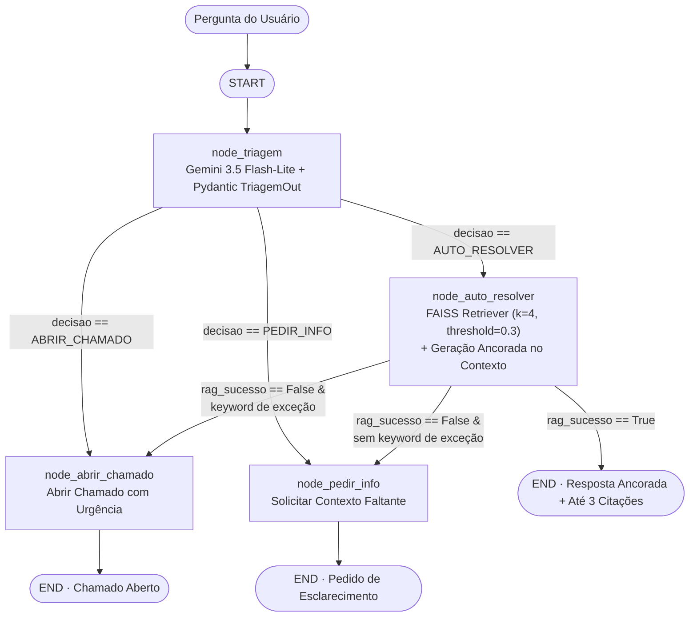

<a id="top"></a>

# Agentic RAG Service Desk Assistant
### Governed Multi-State Triage & Grounded Policy Resolution with LangGraph, Google Gemini & FAISS

<div align="center">

[](#english-version)
[](#versao-em-portugues)

<br/>

[](https://python.org)
[](https://ai.google.dev/)
[](https://langchain-ai.github.io/langgraph/)
[-00A67E)](https://github.com/facebookresearch/faiss)
[](https://docs.pydantic.dev/)
[](#5-testing--validation-suite)

<br/>



</div>

---

<a id="english-version"></a>

> **🇺🇸 English Version** · *[🇧🇷 Ir para a versão em Português](#versao-em-portugues)*
>
> **An end-to-end Agentic RAG system for internal HR & IT Service Desk automation.**
>
> Combines **Pydantic-enforced intent triage**, **threshold-gated FAISS semantic retrieval**, **verifiable document/page citations**, and **deterministic LangGraph fallback routing** to eliminate hallucinations on out-of-scope or policy-exception queries.

## 1. Executive Summary & Problem Statement

Internal Service Desk teams (HR & IT) spend significant operational bandwidth answering repetitive questions about corporate policies mixed with exception requests, access approvals, and ambiguous tickets. Naive RAG chatbots fail in enterprise environments because they:
- Treat every user message as a document lookup—even when the user is requesting a policy exception that requires human approval;
- Hallucinate answers when retrieved chunks have low semantic similarity or fall outside the knowledge base;
- Return opaque answers without verifiable citations (document name, page number, and exact excerpt).

This project solves these failure modes with a **stateful, contract-bound Agentic RAG pipeline**:
1. **Structured Triage (`Pydantic` + `Gemini 3.5 Flash-Lite`):** Classifies every incoming request into a strict typed schema (`AUTO_RESOLVER`, `PEDIR_INFO`, or `ABRIR_CHAMADO`), urgency level (`BAIXA`, `MEDIA`, `ALTA`), and missing context fields.
2. **Threshold-Gated RAG (`FAISS` + `gemini-embedding-001`):** Retrieves only chunks that pass a similarity score threshold (`score_threshold=0.3`, `k=4`) from indexed corporate policy PDFs (`PyMuPDF`), enforcing strict context-only generation (`"Não sei"` on insufficient evidence).
3. **Deterministic Citations & Anti-Hallucination Fallback (`LangGraph`):** Deduplicates and formats up to 3 exact citations (source filename, 1-based page number, and 240-char contextual snippet). Whenever RAG finds no grounded context, the graph deterministically reroutes to ticket escalation (`ABRIR_CHAMADO`) on exception keywords or requests clarification (`PEDIR_INFO`).

---

## 2. System Architecture & LangGraph State Machine



### Typed Graph State (`AgentState`)

| Field | Type | Responsibility |
| :--- | :--- | :--- |
| `pergunta` | `str` | Raw employee query entering the graph |
| `triagem` | `dict` | Validated `TriagemOut` payload (`decisao`, `urgencia`, `campos_faltantes`) |
| `resposta` | `Optional[str]` | Final response returned by RAG, clarification node, or ticket node |
| `citacoes` | `List[dict]` | Up to 3 deduplicated citations (`documento`, `pagina`, `trecho`) |
| `rag_sucesso` | `bool` | Grounding flag (`False` if retriever is empty or LLM returns `"Não sei"`) |
| `acao_final` | `str` | Terminal routing outcome (`AUTO_RESOLVER`, `PEDIR_INFO`, `ABRIR_CHAMADO`) |

---

## 3. Key Engineering Decisions

| Layer | Implementation | Engineering Rationale |
| :--- | :--- | :--- |
| **Structured Triage Contract** | `llm_triagem.with_structured_output(TriagemOut)` (`Pydantic`) | Eliminates fragile regex parsing of LLM outputs; enforces closed `Literal` enums for decision and urgency before routing. |
| **Document Ingestion & Chunking** | `PyMuPDFLoader` + `RecursiveCharacterTextSplitter(chunk_size=300, chunk_overlap=30)` | Preserves page-level metadata (`source`, `page`) across corporate PDFs while keeping chunks focused for high-precision retrieval. |
| **Threshold-Gated Vector Retrieval** | `FAISS` with `search_type="similarity_score_threshold"`, `score_threshold=0.3`, `k=4` | Prevents irrelevant chunks from polluting the prompt window on out-of-scope queries. |
| **Zero-Hallucination Guardrail** | Strict system prompt (`"Não sei"`) + `decidir_pos_auto_resolver` conditional edge | Converts RAG misses into deterministic operational actions (`ABRIR_CHAMADO` for exception keywords like *exceção*, *aprovação*, *liberação*, *acesso especial*; otherwise `PEDIR_INFO`). |
| **Auditable Citations Engine** | `formatar_citacoes()` + `extrair_trecho(janela=240)` | Normalizes whitespace, centers a 240-char excerpt around query keywords ($\ge 4$ chars), deduplicates by `(filename, page)`, and caps output at 3 sources. |
| **Interactive CLI & Notebook Parity** | `main.py` (CLI + test suite + interactive loop) & `main.ipynb` | Enables both automated terminal execution and step-by-step inspection of intermediate embeddings, chunks, and graph transitions. |

---

## 4. Knowledge Base & Functional Evaluation Scenarios

### Indexed Corporate Policy Documents (`dados/`)
- `Politica_Home_Office_e_Reembolso.pdf` — Remote work eligibility, internet/utility reimbursement rules, and exception procedures.
- `Politica_Treinamentos_e_Certificacoes.pdf` — Approved training platforms, technical certifications, and reimbursement limits.
- `Politica_Seguranca_e_Ferramentas_TI.pdf` — Enterprise AI tools, security guidelines, and software access rules.

### Built-in End-to-End Evaluation Suite (`main.py` & `docs/validacao/cenarios.md`)

| # | Test Query | Expected Behavior / Graph Path |
| :-: | :--- | :--- |
| 01 | *"Posso reembolsar a internet?"* | `triagem → auto_resolver → END` (Grounded policy answer + PDF citation) |
| 02 | *"Quero mais 5 dias de trabalho remoto. Como faço?"* | `triagem → abrir_chamado → END` (Policy exception escalated safely) |
| 03 | *"Posso reembolsar cursos ou treinamentos da Alura?"* | `triagem → auto_resolver → END` (Training policy lookup + citation) |
| 04 | *"É possível reembolsar certificações do Google Cloud?"* | `triagem → auto_resolver → END` (Certification policy lookup + citation) |
| 05 | *"Posso obter o Google Gemini de graça?"* | `triagem → auto_resolver → END` (IT tools policy lookup + citation) |
| 06 | *"Preciso de ajuda com uma política."* | `triagem → pedir_info → END` (Ambiguous request prompts for details) |
| 07 | *"Quantas capivaras tem no Rio Pinheiros?"* | `triagem → auto_resolver (RAG miss) → pedir_info → END` (Zero hallucination) |

---

## 5. Testing & Validation Suite

Deterministic helper layers (text normalization, contextual snippet extraction, and citation deduplication/capping) are verified offline without consuming LLM API quota:

- **`tests/test_normalizacao.py`** — Whitespace collapsing, newlines, tabs, empty strings, and `None` safety.
- **`tests/test_extracao.py`** — Case-insensitive keyword windowing, 240-char boundary enforcement, fallback to index `0` when no term matches.
- **`tests/test_citacoes.py`** — Document basename extraction, 1-based page numbering, `(document, page)` deduplication, 3-citation cap, and empty-list handling.
- **`docs/validacao/`** — Dedicated validation specs covering environment, dependencies, execution, security, extraction, normalization, citations, and functional scenarios.

---

## 6. Repository Layout

```text
.
├── assets/
│   └── demo.gif                                  # Animated end-to-end architecture showcase
├── dados/
│   ├── Politica_Home_Office_e_Reembolso.pdf      # Remote work & reimbursement policy (PDF/DOCX)
│   ├── Politica_Seguranca_e_Ferramentas_TI.pdf   # IT security & tools policy (PDF/DOCX)
│   └── Politica_Treinamentos_e_Certificacoes.pdf # Training & certifications policy (PDF/DOCX)
├── docs/
│   └── validacao/                                # Validation checklists & test specifications
│       ├── ambiente.md
│       ├── cenarios.md
│       ├── citacoes.md
│       ├── dependencias.md
│       ├── execucao.md
│       ├── extracao.md
│       ├── normalizacao.md
│       └── seguranca.md
├── tests/
│   ├── test_citacoes.py                          # Citation formatting & deduplication unit tests
│   ├── test_extracao.py                          # Snippet extraction window unit tests
│   ├── test_normalizacao.py                      # Text normalization unit tests
│   └── utils_loader.py                           # Offline test loader utility
├── Guia_Explicativo_Service_Desk_IA.pdf          # Illustrated architecture & code guide (PT-BR)
├── main.py                                       # Production CLI pipeline + 7-scenario suite + interactive mode
├── main.ipynb                                    # Step-by-step interactive notebook walkthrough
├── requirements.txt                              # Python dependencies
├── .env.example                                  # Environment variable template (GOOGLE_API_KEY)
└── README.md                                     # Project documentation
```

---

## 7. Quickstart

### 1. Clone & Set Up Environment
```bash
git clone https://github.com/ManaraMarcelo/ai-agentic-rag-service-desk.git
cd ai-agentic-rag-service-desk

python3 -m venv .venv
source .venv/bin/activate   # Windows: .venv\Scripts\activate
pip install -r requirements.txt
```

### 2. Configure Google Gemini API Key
```bash
cp .env.example .env
# Edit .env and set GOOGLE_API_KEY from https://aistudio.google.com/
```

### 3. Run Offline Unit Tests (No API Key Required)
```bash
python -m unittest discover -s tests -v
```

### 4. Run the Agentic RAG Service Desk Pipeline
```bash
python main.py
```
*Runs all 7 validation scenarios with formatted terminal output and citations, then opens an interactive prompt (`y/n`) for custom questions.*

---

## 8. Tech Stack

- **Language:** Python 3.10+
- **LLM & Embeddings:** Google Gemini (`models/gemini-3.5-flash-lite`, `models/gemini-embedding-001`) via `langchain-google-genai`
- **Agent Orchestration:** `LangGraph` (`StateGraph`, conditional routing) & `LangChain`
- **Vector Store:** `FAISS` (`faiss-cpu`)
- **Document Processing:** `PyMuPDF` (`fitz`) & `RecursiveCharacterTextSplitter`
- **Data Validation:** `Pydantic` (`BaseModel`, `Literal`, structured outputs)

---

## 9. Contributors & Project Context

Developed as the final Artificial Intelligence capstone project for Systems Analysis and Development (ADS — FATEC Arthur Azevedo):
- **Marcelo Manara** — AI Architecture, Prompt Engineering, Structured Output Contracts (`Pydantic`), and Multi-State Orchestration (`LangGraph`)
- **Marcelo Belotto** — Data Pipeline, PDF Ingestion (`PyMuPDF`), Chunking, and Vector Indexing (`FAISS`)
- **Vinicius Emanuel** — Environment Setup, Citation Extraction/Formatting, and Test Suite

---
---

<a id="versao-em-portugues"></a>

# 🇧🇷 Assistente de Service Desk com Agentic RAG

> **Versão em Português** · *[🇺🇸 Back to English Version](#english-version)* · *[⬆️ Topo](#top)*
>
> **Sistema Agentic RAG ponta a ponta para automação de triagem e atendimento de Service Desk corporativo (RH e TI).**
>
> Combina **triagem estruturada com Pydantic**, **busca semântica em FAISS com limiar de similaridade**, **citações auditáveis (arquivo, página e trecho)** e **roteamento determinístico com fallback no LangGraph** para eliminar alucinações em perguntas fora de escopo ou pedidos de exceção.

## 1. Resumo Executivo & Problema Resolvido

Equipes internas de Service Desk (RH e TI) gastam grande esforço operacional respondendo dúvidas repetitivas sobre políticas corporativas misturadas a pedidos de exceção, liberações de acesso e solicitações vagas. Chatbots RAG ingênuos falham em ambientes corporativos porque:
- Tratam toda mensagem como uma busca em documento — mesmo quando o colaborador está pedindo uma exceção que exige aprovação humana;
- Alucinam respostas quando os trechos recuperados têm baixa similaridade semântica ou estão fora da base de conhecimento;
- Entregam respostas opacas sem citações verificáveis (nome do arquivo, número da página e trecho exato).

Este projeto resolve esses problemas com um **pipeline Agentic RAG orientado a estados e contratos**:
1. **Triagem Estruturada (`Pydantic` + `Gemini 3.5 Flash-Lite`):** Classifica cada solicitação recebida em um schema tipado rigoroso (`AUTO_RESOLVER`, `PEDIR_INFO` ou `ABRIR_CHAMADO`), nível de urgência (`BAIXA`, `MEDIA`, `ALTA`) e campos faltantes.
2. **RAG com Limiar de Similaridade (`FAISS` + `gemini-embedding-001`):** Recupera apenas trechos que passam pelo limiar mínimo (`score_threshold=0.3`, `k=4`) dos PDFs de políticas corporativas (`PyMuPDF`), impondo geração estritamente baseada no contexto (`"Não sei"` quando não há evidência suficiente).
3. **Citações Determinísticas & Fallback Anti-Alucinação (`LangGraph`):** Remove duplicatas e formata até 3 citações exatas (nome do arquivo, página base 1 e janela contextual de 240 caracteres). Sempre que o RAG não encontra base, o grafo redireciona deterministicamente para abertura de chamado (`ABRIR_CHAMADO`) em caso de palavras-chave de exceção ou solicita esclarecimentos (`PEDIR_INFO`).

---

## 2. Arquitetura do Sistema & Máquina de Estados (LangGraph)



### Estado Tipado do Grafo (`AgentState`)

| Campo | Tipo | Responsabilidade |
| :--- | :--- | :--- |
| `pergunta` | `str` | Pergunta original do colaborador entrando no grafo |
| `triagem` | `dict` | Payload validado de `TriagemOut` (`decisao`, `urgencia`, `campos_faltantes`) |
| `resposta` | `Optional[str]` | Resposta final retornada pelo RAG, nó de esclarecimento ou nó de chamado |
| `citacoes` | `List[dict]` | Até 3 citações sem duplicatas (`documento`, `pagina`, `trecho`) |
| `rag_sucesso` | `bool` | Flag de ancoragem (`False` se o retriever vier vazio ou o LLM responder `"Não sei"`) |
| `acao_final` | `str` | Resultado terminal do roteamento (`AUTO_RESOLVER`, `PEDIR_INFO`, `ABRIR_CHAMADO`) |

---

## 3. Principais Decisões de Engenharia

| Camada | Implementação | Justificativa Técnica |
| :--- | :--- | :--- |
| **Contrato de Triagem Estruturada** | `llm_triagem.with_structured_output(TriagemOut)` (`Pydantic`) | Elimina parsing frágil por regex em saídas de LLM; impõe enums `Literal` fechados para decisão e urgência antes do roteamento. |
| **Ingestão & Chunking de Documentos** | `PyMuPDFLoader` + `RecursiveCharacterTextSplitter(chunk_size=300, chunk_overlap=30)` | Preserva metadados de página (`source`, `page`) nos PDFs corporativos mantendo chunks focados para alta precisão na busca. |
| **Busca Vetorial com Limiar** | `FAISS` com `search_type="similarity_score_threshold"`, `score_threshold=0.3`, `k=4` | Impede que trechos irrelevantes contaminem a janela do prompt em perguntas fora de escopo. |
| **Trava Zero-Alucinação** | Prompt de sistema estrito (`"Não sei"`) + aresta condicional `decidir_pos_auto_resolver` | Converte falhas do RAG em ações operacionais determinísticas (`ABRIR_CHAMADO` para keywords como *exceção*, *aprovação*, *liberação*, *acesso especial*; caso contrário `PEDIR_INFO`). |
| **Motor de Citações Auditáveis** | `formatar_citacoes()` + `extrair_trecho(janela=240)` | Normaliza espaços, centraliza um recorte de 240 caracteres em torno dos termos da pergunta ($\ge 4$ chars), deduplica por `(arquivo, página)` e limita a 3 fontes. |
| **Paridade CLI & Notebook** | `main.py` (CLI + bateria de testes + modo interativo) & `main.ipynb` | Permite tanto execução automatizada no terminal quanto inspeção passo a passo de embeddings, chunks e transições do grafo. |

---

## 4. Base de Conhecimento & Cenários Funcionais de Avaliação

### Documentos de Políticas Corporativas Indexados (`dados/`)
- `Politica_Home_Office_e_Reembolso.pdf` — Elegibilidade para trabalho remoto, regras de reembolso de internet/despesas e procedimentos de exceção.
- `Politica_Treinamentos_e_Certificacoes.pdf` — Plataformas de treinamento homologadas, certificações técnicas e limites de reembolso.
- `Politica_Seguranca_e_Ferramentas_TI.pdf` — Ferramentas corporativas de IA, diretrizes de segurança e regras de acesso a software.

### Bateria de Avaliação Ponta a Ponta (`main.py` & `docs/validacao/cenarios.md`)

| # | Pergunta de Teste | Comportamento Esperado / Caminho no Grafo |
| :-: | :--- | :--- |
| 01 | *"Posso reembolsar a internet?"* | `triagem → auto_resolver → END` (Resposta ancorada + citação do PDF) |
| 02 | *"Quero mais 5 dias de trabalho remoto. Como faço?"* | `triagem → abrir_chamado → END` (Exceção escalonada com segurança) |
| 03 | *"Posso reembolsar cursos ou treinamentos da Alura?"* | `triagem → auto_resolver → END` (Consulta à política de treinamentos + citação) |
| 04 | *"É possível reembolsar certificações do Google Cloud?"* | `triagem → auto_resolver → END` (Consulta à política de certificações + citação) |
| 05 | *"Posso obter o Google Gemini de graça?"* | `triagem → auto_resolver → END` (Consulta à política de ferramentas de TI + citação) |
| 06 | *"Preciso de ajuda com uma política."* | `triagem → pedir_info → END` (Pedido ambíguo solicita mais detalhes) |
| 07 | *"Quantas capivaras tem no Rio Pinheiros?"* | `triagem → auto_resolver (falha no RAG) → pedir_info → END` (Zero alucinação) |

---

## 5. Suíte de Testes & Validação

As camadas auxiliares determinísticas (normalização de texto, extração de trecho contextual e deduplicação/limite de citações) são verificadas offline sem consumir cota da API de LLM:

- **`tests/test_normalizacao.py`** — Colapso de espaços em branco, quebras de linha, tabs, strings vazias e segurança contra `None`.
- **`tests/test_extracao.py`** — Janela de busca case-insensitive por palavras-chave, limite de 240 caracteres e fallback para índice `0` quando nenhum termo corresponde.
- **`tests/test_citacoes.py`** — Extração do nome do arquivo, numeração de página base 1, deduplicação por `(documento, página)`, limite de 3 citações e tratamento de lista vazia.
- **`docs/validacao/`** — Especificações dedicadas cobrindo ambiente, dependências, execução, segurança, extração, normalização, citações e cenários funcionais.

---

## 6. Estrutura do Repositório

```text
.
├── assets/
│   └── demo.gif                                  # Demonstração animada da arquitetura ponta a ponta
├── dados/
│   ├── Politica_Home_Office_e_Reembolso.pdf      # Política de home office e reembolso (PDF/DOCX)
│   ├── Politica_Seguranca_e_Ferramentas_TI.pdf   # Política de segurança e ferramentas de TI (PDF/DOCX)
│   └── Politica_Treinamentos_e_Certificacoes.pdf # Política de treinamentos e certificações (PDF/DOCX)
├── docs/
│   └── validacao/                                # Checklists de validação e especificações de teste
│       ├── ambiente.md
│       ├── cenarios.md
│       ├── citacoes.md
│       ├── dependencias.md
│       ├── execucao.md
│       ├── extracao.md
│       ├── normalizacao.md
│       └── seguranca.md
├── tests/
│   ├── test_citacoes.py                          # Testes unitários de formatação e deduplicação de citações
│   ├── test_extracao.py                          # Testes unitários de janela de extração de trechos
│   ├── test_normalizacao.py                      # Testes unitários de normalização de texto
│   └── utils_loader.py                           # Utilitário offline para carregar funções nos testes
├── Guia_Explicativo_Service_Desk_IA.pdf          # Guia ilustrado da arquitetura e do código (PT-BR)
├── main.py                                       # Pipeline CLI + bateria de 7 cenários + modo interativo
├── main.ipynb                                    # Notebook interativo passo a passo
├── requirements.txt                              # Dependências Python
├── .env.example                                  # Modelo de variável de ambiente (GOOGLE_API_KEY)
└── README.md                                     # Documentação do projeto
```

---

## 7. Como Executar (Quickstart)

### 1. Clonar e Configurar o Ambiente
```bash
git clone https://github.com/ManaraMarcelo/ai-agentic-rag-service-desk.git
cd ai-agentic-rag-service-desk

python3 -m venv .venv
source .venv/bin/activate   # Windows: .venv\Scripts\activate
pip install -r requirements.txt
```

### 2. Configurar a Chave de API do Google Gemini
```bash
cp .env.example .env
# Edite o arquivo .env e preencha GOOGLE_API_KEY (obtida em https://aistudio.google.com/)
```

### 3. Rodar os Testes Unitários Offline (Sem Chave de API)
```bash
python -m unittest discover -s tests -v
```

### 4. Executar o Pipeline Agentic RAG de Service Desk
```bash
python main.py
```
*Executa os 7 cenários de validação com saída formatada e citações no terminal e, em seguida, abre um prompt interativo (`y/n`) para perguntas personalizadas.*

---

## 8. Stack Tecnológica

- **Linguagem:** Python 3.10+
- **LLM & Embeddings:** Google Gemini (`models/gemini-3.5-flash-lite`, `models/gemini-embedding-001`) via `langchain-google-genai`
- **Orquestração de Agentes:** `LangGraph` (`StateGraph`, roteamento condicional) & `LangChain`
- **Banco Vetorial:** `FAISS` (`faiss-cpu`)
- **Processamento de Documentos:** `PyMuPDF` (`fitz`) & `RecursiveCharacterTextSplitter`
- **Validação de Dados:** `Pydantic` (`BaseModel`, `Literal`, saídas estruturadas)

---

## 9. Integrantes & Contexto do Projeto

Projeto final desenvolvido para a disciplina de Inteligência Artificial do curso de Análise e Desenvolvimento de Sistemas (ADS — FATEC Arthur Azevedo):
- **Marcelo Manara** — Arquitetura de IA, Engenharia de Prompt, Contratos Estruturados (`Pydantic`) e Orquestração Multi-Estado (`LangGraph`)
- **Marcelo Belotto** — Pipeline de Dados, Ingestão de PDFs (`PyMuPDF`), Chunking e Indexação Vetorial (`FAISS`)
- **Vinicius Emanuel** — Configuração de Ambiente, Extração/Formatação de Citações e Suíte de Testes
